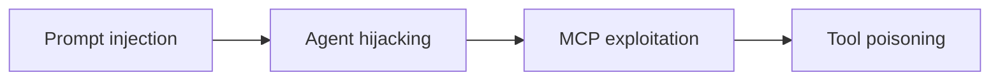

<div align="center">

# Coff0xc

**AI Security Researcher**

Reproducible tools for authorized testing — turning attack paths into defensive evidence.

<a href="https://github.com/Coff0xc?tab=followers"></a>&nbsp;
<a href="https://github.com/Coff0xc?tab=repositories&sort=stargazers"></a>&nbsp;


</div>

---

## Focus



Four links in one chain. I work on LLM and agent red teaming, MCP and tool security, secret and token exposure, and the defensive automation that turns findings into repeatable evidence: CI-friendly reports, SARIF output, ATT&CK-style mapping, and test artifacts that run the same way twice.

---

## Projects

<table>
<tr>
<td width="50%">

#### [AutoRedTeam-Orchestrator](https://github.com/Coff0xc/AutoRedTeam-Orchestrator)

Local MCP / AI attack-surface audit and evidence gate for authorized testing. SDK, CLI, MCP, Docker sandboxing, and CI artifacts.

[](https://github.com/Coff0xc/AutoRedTeam-Orchestrator/stargazers) [](https://github.com/Coff0xc/AutoRedTeam-Orchestrator)

</td>
<td width="50%">

#### [Github-API-scan](https://github.com/Coff0xc/Github-API-scan)

Scans GitHub and local git for leaked AI API keys across 50+ platforms. Pairs each key with its relay URL and checks whether it still works.

[](https://github.com/Coff0xc/Github-API-scan/stargazers) [](https://github.com/Coff0xc/Github-API-scan)

</td>
</tr>
<tr>
<td width="50%">

#### [catchclaw](https://github.com/Coff0xc/catchclaw)

Multi-platform agent security testing with DAG-style attack chains and Rust components. Covers 9 agent platforms with exploit modules and ATT&CK mapping.

[](https://github.com/Coff0xc/catchclaw/stargazers) [](https://github.com/Coff0xc/catchclaw)

</td>
<td width="50%">

#### [LLM-Security-Assessment-Framework](https://github.com/Coff0xc/LLM-Security-Assessment-Framework)

Evolutionary framework for LLM security assessment: 6 attack methods, 18 model adapters, and a Vue 3 dashboard for structured resilience measurement.

[](https://github.com/Coff0xc/LLM-Security-Assessment-Framework/stargazers) [](https://github.com/Coff0xc/LLM-Security-Assessment-Framework)

</td>
</tr>
<tr>
<td width="50%">

#### [CTF-MCP](https://github.com/Coff0xc/CTF-MCP)

MCP server for CTF workflows: 126 tools across web, crypto, and pwn, with risk levels and warnings on the dangerous ones.

[](https://github.com/Coff0xc/CTF-MCP/stargazers) [](https://github.com/Coff0xc/CTF-MCP)

</td>
<td width="50%">

#### [coffee-skill](https://github.com/Coff0xc/coffee-skill)

Installable Codex / agent-skills workflow pack for dev, Agent / RAG, API / data, Office artifacts, research diagrams, and authorized security review.

[](https://github.com/Coff0xc/coffee-skill/stargazers) [](https://github.com/Coff0xc/coffee-skill)

</td>
</tr>
</table>

---

## Principles

- **Authorized testing only.** Research code is for owned systems, lab environments, CTFs, or explicitly approved assessments.
- **Evidence over claims.** Reproducible commands, logs, SARIF, screenshots, and minimal proof artifacts — not assertions.
- **Defender-first.** Methods are published in a way that helps detection, hardening, and regression testing.
- **Small tools, sharp boundaries.** No hidden production assumptions, no credential leakage, no irreversible actions.

---

## Toolbox

<p align="center">
  
</p>

---

## Contributions

Private contribution visibility is controlled by GitHub profile settings. The graph below is generated from visible profile activity instead of third-party stats cards.

<picture>
  <source media="(prefers-color-scheme: dark)" srcset="https://raw.githubusercontent.com/Coff0xc/Coff0xc/output/github-snake-dark.svg" />
  <source media="(prefers-color-scheme: light)" srcset="https://raw.githubusercontent.com/Coff0xc/Coff0xc/output/github-snake.svg" />
  
</picture>

---

<div align="center">

```text
COFF0XC :: break carefully, document clearly
```

</div>
